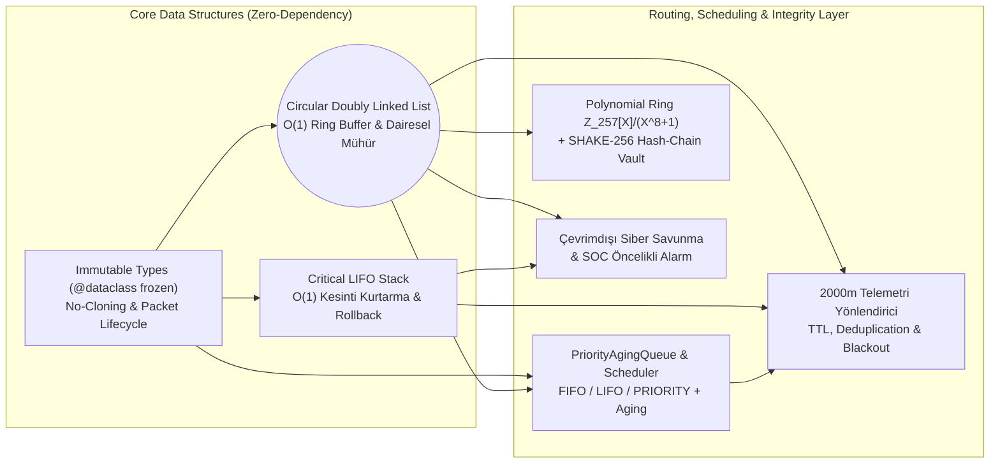

# AstroQ-Link


-brightgreen)

)-blueviolet)

**AstroQ-Link**, çalışma zamanında hiçbir harici kütüphane kullanmadan (**zero runtime dependency**) sıfırdan geliştirilmiş; işaretçi tabanlı **Çift Yönlü Dairesel Bağlı Liste (`CircularDoublyLinkedList`)**, **Kritik LIFO Yığını (`CriticalLIFOStack`)**, **Açlık Önlemeli Öncelik Kuyruğu (`PriorityAgingQueue`)** ve **dairesel bütünlük zincirleme** mimarilerini birleştiren, kesinti toleranslı telemetri yönlendirme ve doğrulanabilir veri depolama kütüphanesidir.

---

## 1. Bu Uygulamayı Ne Amacıyla Yaptık?

Uç sistemlerde (roket/uydu aviyonik hatları ve bağlantısı kesilebilen saha düğümleri) hazır veri yapıları ve klasik iletişim kuyrukları üç temel darboğaz yaratır: **RAM şişmesi**, **kesinti sonrası bayat/düşük öncelikli veri gecikmesi** ve **işlem/iletim sırasındaki veri bozulmaları**.

AstroQ-Link bu problemlere temel veri yapıları düzeyinde çözüm üretir:

* **Sınırsız Veri Akışında Sabit Bellek ($O(1)$ RAM):** Sürekli üretilen sensör paketlerini büyüyen listeler yerine sabit kapasiteli `CircularDoublyLinkedList` halkasında tutarak, kapasite dolduğunda en eski düğümün üzerine $O(1)$ sürede yazar ve bellek ayak izini sabitler.
* **Kesinti (Blackout) Sonrası Akıllı Kurtarma ve Önceliklendirme:** Bağlantı kesildiğinde biriken paketleri seçilen politikaya göre (**LIFO** ile en güncel durum öncelikli, **FIFO** ile sırayla veya **PRIORITY + Aging** ile aciliyet ve bekleme süresine göre) yönetir; süresi dolmuş (`TTL`) ve yinelenen (`duplicate`) paketleri eler.
* **Bellek İçi Değişmezlik ve Atomik Geri Alma (Rollback):** Telemetri paketlerini `frozen=True` ve `__slots__` ile koruyarak (`QuantumTelemetryPacket`) bellek içi değişiklikleri ve kopyalamayı (`NoCloningViolationError`) engeller; dosya ve çerçeve işlemlerinde hata veya bozulma anında adımları ters sırada geri sarar.

---

## 2. Bizi Ayırt Eden Mühendislik ve Algoritma Yaklaşımları

Klasik yazılımlarda veri tamponlama, paket zamanlama ve bütünlük kontrolü birbirinden kopuk katmanlar olarak çalışır. AstroQ-Link'i ayırt eden temel yaklaşım, **veri yapılarının kendi topolojisini doğrudan kurtarma ve doğrulama mekanizmasına dönüştürmektir**:

### A. Veri Yapısı Topolojisi ile Bütünlük Kontrolünün Birleşimi (`Tail -> Head` Dairesel Mühür)
* **Uygulandığı Yer:** `src/astroq_link/crypto/pqc_vault.py` (`PQCFileVault`)
* **Yaklaşım:** Veriler 64 baytlık bloklara ayrılır ve her blok düğümü (`CipherBlock`), kendi `SHA3-256` özetini kendinden önceki tüm blokların kümülatif özetiyle zincirleyerek `CircularDoublyLinkedList` üzerinde bağlanır. Ardından çift yönlü işaretçiler (`head.prev` $\rightarrow$ `tail`) kullanılarak **son düğüm ilk düğüme kilitlenir**. Bu kapalı halka topolojisi, tek bir bayttaki bozulmanın (`bit-flip`) zinciri kırmasını ve doğrulama başarısız olduğunda diske tek bayt bile bozuk veri yazılmamasını sağlar.

### B. Paket Yaşam Döngüsü, Açlık Önleme (Aging) ve Politika Kıyaslaması
* **Uygulandığı Yer:** `src/astroq_link/engine/telemetry_router.py` ve `scheduler.py`
* **Yaklaşım:**
  * **Yaşam Döngüsü ve TTL:** Her paket `CREATED -> BUFFERED -> TRANSMITTED -> DELIVERED` (veya `DROPPED` / `EXPIRED`) durum geçişleriyle izlenir; `packet_id` üzerinden tekrarlanan paketler ayıklanır.
  * **Starvation Prevention (Aging):** `PriorityAgingQueue`, sürekli `CRITICAL` paket akışı altında `NORMAL` ve `IMPORTANT` paketlerin sonsuza kadar beklemesini önlemek için bekleme süresine göre dinamik öncelik terfisi uygular; tampon dolduğunda ise yüksek öncelikli paket lehine en düşük öncelikli eski paketi düşürür (*preemption*).
  * **Çoklu Politika Kıyaslaması (`compare_scheduling_strategies`):** Aynı kesinti iş yükü üzerinde **FIFO**, **LIFO** ve **PRIORITY** algoritmalarının kritik paket gecikmesi, paket kayıp oranı ve bayat (*stale*) paket oranları nicel olarak ölçülür.

### C. Polinom Halkası, Sünger Akışı ve Bellek Sıfırlama
* **Uygulandığı Yer:** `src/astroq_link/crypto/lattice_kdf.py` ve `engine/offline_shield.py`
* **Yaklaşım:** $\mathbb{Z}_{257}[X]/(X^8 + 1)$ polinom halkası üzerinde negatif çevrimli polinom çarpımı ($b = a \cdot s + e \pmod{q, X^n + 1}$) ile oturum tohumu üretilir; `SHAKE-256` (XOF) ile her bloğun anahtar akışı bir önceki bloğun kümülatif özetine bağlanır (*key ratcheting*). Kullanımı biten anahtar tamponları `secure_zero_bytearray` ile doğrudan `bytearray` üzerinde `0x00` yazılarak sıfırlanır.

### D. Property-Based Testing ile Matematiksel Invariant Doğrulaması
* **Uygulandığı Yer:** `tests/test_invariants_and_properties.py`
* **Yaklaşım:** Standart birim testlerine ek olarak `Hypothesis` kütüphanesi ile yüzlerce rastgele `append`, `remove`, `rotate_forward`, `rotate_backward` ve `clear` dizisi üretilir; her adımda `head.prev == tail`, `tail.next == head`, düğüm benzersizliği ve çift yönlü tutarlılık invariant'ları Python'ın `collections.deque` referans modeliyle birebir doğrulanır.

---

## 3. Güvenlik Kapsamı ve Tasarım Sınırları (Threat Model)

Bu proje, özel veri yapılarının performansını ve bütünlük zincirleme mimarisini göstermek amacıyla **sıfır çalışma zamanı bağımlılığıyla** geliştirilmiş bir sistem mühendisliği prototipidir. Kriptografik bileşenlerin kapsamı ve sınırları aşağıda açıkça belirtilmiştir:

* **Anahtar Türetme (`lattice_kdf.py`):** $\mathbb{Z}_{257}[X]/(X^8 + 1)$ halkası üzerinde çalışan, **Ring-LWE esinli eğitim amaçlı bir anahtar türetme deneyidir** (*Ring-LWE-inspired educational key derivation experiment*). Standartlaştırılmış NIST PQC parametreleri (örn. ML-KEM $n=256, q=3329$) yerine kavramsal gösterim için küçük polinom boyutları kullanılmıştır ve rastgele `salt` / yavaşlatılmış parola KDF'i içermez; üretim güvenliği iddiası taşımaz.
* **Akış Şifreleme (`pqc_vault.py`):** Bloklar `SHAKE-256` anahtar akışı ile XOR'lanır. Dosya başına rastgele `Nonce/IV` veya standart bir AEAD (AES-GCM / ChaCha20-Poly1305) yapısı içermediğinden, aynı parola ile tekrarlı şifrelemelerde deterministik anahtar akışı (*keystream reuse*) oluşur.
* **Bütünlük Kontrolü (Tamper Detection):** `CircularDoublyLinkedList` üzerinde kurulan `Tail -> Head` dairesel zinciri, gizli anahtarlı bir `HMAC`/`KMAC` değil, **anahtarsız kümülatif bir hash zinciridir**. Dosyayı yeniden yazma yetkisine sahip aktif bir saldırgana karşı kriptografik kimlik doğrulama (*authentication*) sağlamaz; iletim hatalarını ve tek bitlik bozulmaları (*bit-flip*) tespit eden bir bütünlük prototipidir.

---

## 4. Sistem Mimarisi ve Karmaşıklık Özeti



| Bileşen | Veri Yapısı | Zaman Karmaşıklığı | Bellek Karmaşıklığı |
| :--- | :--- | :---: | :---: |
| **Sabit Bellekli Telemetri Tamponu** | `CircularDoublyLinkedList` | $O(1)$ ekleme / üzerine yazma | $O(K)$ sabit kapasite |
| **Dairesel Hash-Chain Mührü** | `CircularDoublyLinkedList` | $O(N)$ blok zincirleme | $O(1)$ akış (streaming) |
| **Kesinti & Saldırı Kurtarma** | `CriticalLIFOStack` | $O(1)$ `push` / `pop` | $O(M)$ kritik yığın |
| **Atomik İşlem Geri Alma (Rollback)** | `CriticalLIFOStack` | $O(1)$ adım başı geri alma | $O(M)$ işlem kaydı |
| **Açlık Önlemeli Öncelik Kuyruğu** | `PriorityAgingQueue` (CDLL tabanlı) | $O(M)$ aging taraması | $O(M)$ sabit kapasite |

---

## 5. Ölçülen Performans Sonuçları

| Test Senaryosu | Klasik Yaklaşım | AstroQ-Link Mimarisi | Ölçülen Kazanım |
| :--- | :---: | :---: | :---: |
| **10.000 Paket Kesinti Sonrası İlk Kritik Yanıt** | 182.40 µs (`deque` FIFO) | **1.90 µs (`CriticalLIFOStack`)** | **96.0x daha hızlı** |
| **50.000 Paket Akışında Tepe RAM Tüketimi** | $O(N)$ doğrusal bellek artışı | **8.52 KB (32 düğüm sabit)** | **$O(1)$ sabit bellek** |
| **1-Bit Girdi Değişiminde Çığ Etkisi (4 KB)** | — | **%49.33 bit değişimi** | İdeal difüzyon (~%50) |
| **1-Bayt Kurcalama (Bit-Flip) Saldırısı** | Bozuk veri diske yazılır | **Anında engellendi (`False`)** | Sıfır veri sızıntısı |

---

## 6. Geliştirme Yol Haritası (Roadmap)

* [x] **Milestone 1 — Correctness:** `CircularDoublyLinkedList` ve `CriticalLIFOStack` sınır durumları (`capacity=1`, `clear`, `remove`), pointer invariant doğrulamaları ve `Hypothesis` property-based testleri.
* [x] **Milestone 2 — Telemetry Core:** `PacketPriority` (`NORMAL`, `IMPORTANT`, `CRITICAL`), yaşam döngüsü durumları, `TTL` süre aşımı, duplicate tespiti, `PriorityAgingQueue` (starvation prevention) ve FIFO/LIFO/Priority karşılaştırma motoru.
* [ ] **Milestone 3 — Reliability & Channel Physics:** Latency, bandwidth limiti, packet loss olasılığı, jitter, timeout/retry ve dinamik QBER + hysteresis kanal geçişi.
* [ ] **Milestone 4 — Security Separation:** Experimental prototip ile üretim standartlarında AEAD + Salt/KDF + HMAC katmanlarının ayrılması.
* [ ] **Milestone 5–8 — Benchmarks, CI/CD & Showcase:** İstatistiksel (median/P95) benchmark raporları, GitHub Actions CI, etkileşimli CLI ve görselleştirme paneli.

---

## 7. Kurulum ve Çalıştırma

Çekirdek kütüphane harici paket gerektirmez. Test paketini (`pytest` ve `hypothesis`) çalıştırmak için:

```bash
# Opsiyonel test bağımlılıklarını yükleme
pip install -e ".[dev]"

# Tüm birim testlerini ve Hypothesis property-based testlerini çalıştırma
python -m pytest -v

# Alan demolarını çalıştırma
python examples/01_rocket_2000m_blackout.py
python examples/02_offline_cyber_defense.py
python examples/03_pqc_file_encryption_demo.py

# Benchmark ölçümlerini çalıştırma
python benchmarks/fifo_vs_lifo_latency.py
python benchmarks/avalanche_and_memory.py

# CLI üzerinden şifreleme, doğrulama ve simülasyon
PYTHONPATH=src python -m astroq_link.io.cli encrypt data/sample_telemetry.csv secret.pqc -p "GucluParola2026"
PYTHONPATH=src python -m astroq_link.io.cli decrypt secret.pqc restored.csv -p "GucluParola2026"
PYTHONPATH=src python -m astroq_link.io.cli simulate --altitude 2000 --export-csv data/ground_log.csv
```