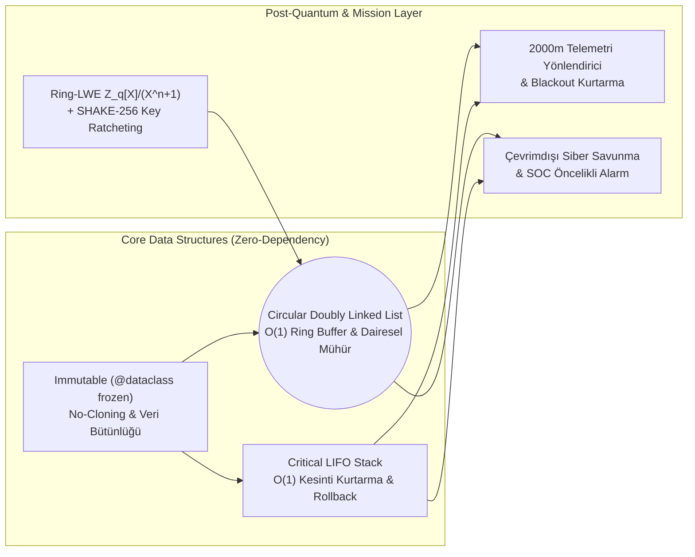

# AstroQ-Link


-brightgreen)


**AstroQ-Link**, hiçbir harici kütüphane kullanmadan (**zero-dependency**) sıfırdan inşa edilmiş; işaretçi tabanlı **Çift Yönlü Dairesel Bağlı Liste (`CircularDoublyLinkedList`)**, **Kritik LIFO Yığını (`CriticalLIFOStack`)** ve **Post-Quantum Kriptografi (`Ring-LWE` + `SHAKE-256`)** mimarilerini birleştiren, kesinti toleranslı telemetri yönlendirme ve siber savunma kütüphanesidir.

---

## 1. Bu Uygulamayı Ne Amacıyla Yaptık?

Uç sistemlerde (roket/uydu aviyonik hatları ve internet bağlantısı kopabilen saha düğümleri) standart veri yapıları ve klasik şifreleme yöntemleri üç kritik soruna yol açar: **RAM şişmesi**, **kesinti sonrası bayat veri gecikmesi** ve **veri kurcalama/kuantum tehditleri**.

AstroQ-Link'i bu üç problemi temel veri yapıları düzeyinde çözmek amacıyla geliştirdik:

* **Sınırsız Veri Akışında Bellek Taşmasını Önlemek ($O(1)$ RAM):** Roket uçuşu boyunca sürekli üretilen sensör paketlerini büyüyen listeler yerine sabit kapasiteli `CircularDoublyLinkedList` halkasında tutarak, kapasite dolduğunda en eski düğümün üzerine $O(1)$ sürede yazmak ve bellek tüketimini sabitlemek.
* **Sinyal Kesintisi (Blackout) Sonrası En Güncel Durumu Kurtarmak:** Klasik FIFO kuyruklar bağlantı geri geldiğinde önce eski paketleri boşaltır. Biz ise kesinti anındaki kritik paketleri `CriticalLIFOStack` yığınına alarak, bağlantı döndüğü anda yığının tepesindeki **en son uçuş durumunu** $O(1)$ sürede yer istasyonuna ulaştırmayı amaçladık.
* **Kuantum Kopyalanamazlık ve Değişmezlik İlkesini Uygulamak:** Telemetri paketlerini ve güvenlik kayıtlarını `frozen=True` ve `__slots__` ile koruyarak (`QuantumTelemetryPacket`), bellek üzerinde yetkisiz değişikliği ve `copy`/`deepcopy` ile kopyalanmasını (`NoCloningViolationError`) engellemek.

---

## 2. Post-Quantum (Kuantum Sonrası) Kriptografiyi Nerede Kullandık?

Kuantum bilgisayarların klasik açık anahtarlı kriptografiyi (RSA/ECC) tehdit etmesine karşı, projede kafes tabanlı (**Lattice-Based**) ve sünger fonksiyonu (**Sponge Construction**) tabanlı kuantum-dirençli mekanizmaları **üç temel noktada** entegre ettik:

1. **Kafes Tabanlı Anahtar Türetme (`src/astroq_link/crypto/lattice_kdf.py` — `LatticeKeyDeriver`):**
   * Polinom halkası $Z_q[X]/(X^n + 1)$ üzerinde **Ring-LWE (Learning With Errors)** denklemini ($b = a \cdot s + e \pmod{q, X^n + 1}$) gerçekleyerek kullanıcı parolasından kuantum-dirençli ana oturum tohumu (`master_seed`) ürettik.
   * Her veri bloğu için bir önceki bloğun özetine bağlı (**Key Ratcheting**) **SHAKE-256** anahtar akışı türettik ve kullanılan anahtar tamponlarını `secure_zero_bytearray` ile anında RAM üzerinde sıfırladık (*Memory Zeroization*).
2. **Dairesel Mühürlü Dosya Kasası (`src/astroq_link/crypto/pqc_vault.py` — `PQCFileVault`):**
   * Dosyaları 64 baytlık bloklara bölüp Ring-LWE + SHAKE-256 anahtar akışıyla şifreledik ve her bloğu kümülatif MAC özetleriyle `CircularDoublyLinkedList` üzerinde birbirine bağladık.
   * Listenin en son düğümünü (`tail`) ilk düğümüne (`head`) kilitleyen **Dairesel Kapanış Mührü (`_compute_circular_seal`)** sayesinde dosya üzerindeki **1 bitlik kurcalamayı bile** yakalayıp bozuk verinin diske yazılmasını engelledik.
3. **Çevrimdışı Siber Savunma Kalkanı (`src/astroq_link/engine/offline_shield.py` — `AutonomousEdgeShield`):**
   * Merkez sunucu/internet bağlantısı kesildiğinde, 4 yuvalı dairesel anahtar halkası üzerinde **SHAKE-256** ile yerel anahtar döndürme (*Offline Forward Secrecy*) uygulayıp eski anahtar slotlarını bellekte sıfırladık.

---

## 3. Neyi Test Ettik ve Ne Ölçtük?

Uygulamanın doğruluğunu, güvenlik dayanıklılığını ve zaman/bellek karmaşıklığını **3 farklı katmanda** test ettik:

### A. Birim ve Sınır Durumu Testleri (`tests/` — 26 Otomatik Test)
* **İşaretçi Bütünlüğü (`test_circular_dll.py`):** Boş liste, tek düğümde kendi kendine işaret etme (`head.next is head`), baştan/ortadan/sondan silme, ileri-geri döndürme (`O(1)` kanal geçişi) ve sabit kapasitede üzerine yazma davranışları doğrulandı.
* **Değişmezlik ve No-Cloning (`test_immutability.py`):** Paketlerin sonradan değiştirilemediği ve kopyalama girişimlerinde `NoCloningViolationError` fırlatıldığı test edildi.
* **1-Bayt Kurcalama ve Atomik Rollback (`test_pqc_vault.py`):** Şifreli dosyanın ortasındaki 1 bayt değiştirildiğinde (`Bit-Flip`) `IntegrityTamperError` fırlatıldığı ve diske tek bayt bile bozuk veri yazılmadığı; şifreleme ortasında disk hatası oluştuğunda ise `CriticalLIFOStack` ile yarım kalan dosyanın atomik olarak geri alınıp silindiği test edildi.
* **Kesinti ve Çevrimdışı Saldırı Senaryoları (`test_engine.py`, `test_io.py`):** 2000m roket kesintisinde en güncel paketin ilk kurtarıldığı, çevrimdışı modda yakalanan saldırıların bağlantı döndüğünde SOC merkezine LIFO sırasıyla iletildiği ve CLI çıkış kodlarının (`0`, `1`, `2`) doğruluğu test edildi.

### B. Gerçekçi Görev Simülasyonları (`examples/` — 3 Alan Demosu)
* **`01_rocket_2000m_blackout.py`:** 0m'den 2000m tepe noktasına çıkışta `1880m–1940m` arasındaki RF kesintisi ve `1600m` civarındaki QBER (> 0.11) kuantum kanal ihlali simüle edildi; tamponun 16 düğümde sabit kaldığı ve kesintideki kritik paketlerin eksiksiz kurtarıldığı doğrulandı.
* **`02_offline_cyber_defense.py`:** İnternet kesik iken `T=3` ve `T=4` anlarında enjekte edilen 1-baytlık saldırılar engellendi, geri sarıldı ve `T=6`'da bağlantı döndüğünde SOC merkezine önce `T=4`, ardından `T=3` alarmı iletildi.
* **`03_pqc_file_encryption_demo.py`:** Gerçek bir telemetri CSV dosyası şifrelendi, `101. baytta` bit-flip saldırısı uygulandı ve `Diske Bozuk Veri Yazıldı mı? : False` çıktısıyla koruma doğrulandı.

### C. Nicel Performans ve Kriptografik Benchmarklar (`benchmarks/`)

| Test Senaryosu | Klasik Yaklaşım | AstroQ-Link Mimarisi | Ölçülen Kazanım |
| :--- | :---: | :---: | :---: |
| **10.000 Paket Kesinti Sonrası İlk Kritik Yanıt** | 182.40 µs (`deque` FIFO) | **1.90 µs (`CriticalLIFOStack`)** | **96.0x daha hızlı** |
| **50.000 Paket Akışında Tepe RAM Tüketimi** | $O(N)$ doğrusal bellek artışı | **8.52 KB (32 düğüm sabit)** | **$O(1)$ sabit bellek** |
| **1-Bit Girdi Değişiminde Çığ Etkisi (4 KB)** | — | **%49.33 bit değişimi** | İdeal difüzyon (~%50) |
| **1-Bayt Kurcalama (Bit-Flip) Saldırısı** | Bozuk veri diske yazılır | **Anında engellendi (`False`)** | Sıfır veri sızıntısı |

---

## Sistem Mimarisi ve Karmaşıklık Özeti



| Bileşen | Veri Yapısı | Zaman Karmaşıklığı | Bellek Karmaşıklığı |
| :--- | :--- | :---: | :---: |
| **Sabit Bellekli Telemetri Tamponu** | `CircularDoublyLinkedList` | $O(1)$ ekleme / üzerine yazma | $O(K)$ sabit kapasite |
| **Dairesel Kriptografik Mühür** | `CircularDoublyLinkedList` | $O(N)$ blok zincirleme | $O(1)$ akış (streaming) |
| **Kesinti & Saldırı Kurtarma** | `CriticalLIFOStack` | $O(1)$ `push` / `pop` | $O(M)$ kritik yığın |
| **Atomik İşlem Geri Alma (Rollback)** | `CriticalLIFOStack` | $O(1)$ adım başı geri alma | $O(M)$ işlem kaydı |

---

## Kurulum ve Çalıştırma

```bash
# 1. Tüm birim testlerini çalıştırma (26 test)
python -m pytest -v

# 2. Alan demolarını çalıştırma
python examples/01_rocket_2000m_blackout.py
python examples/02_offline_cyber_defense.py
python examples/03_pqc_file_encryption_demo.py

# 3. Benchmark ölçümlerini çalıştırma
python benchmarks/fifo_vs_lifo_latency.py
python benchmarks/avalanche_and_memory.py

# 4. CLI üzerinden şifreleme, doğrulama ve simülasyon
PYTHONPATH=src python -m astroq_link.io.cli encrypt data/sample_telemetry.csv secret.pqc -p "GucluParola2026"
PYTHONPATH=src python -m astroq_link.io.cli decrypt secret.pqc restored.csv -p "GucluParola2026"
PYTHONPATH=src python -m astroq_link.io.cli simulate --altitude 2000 --export-csv data/ground_log.csv
```
