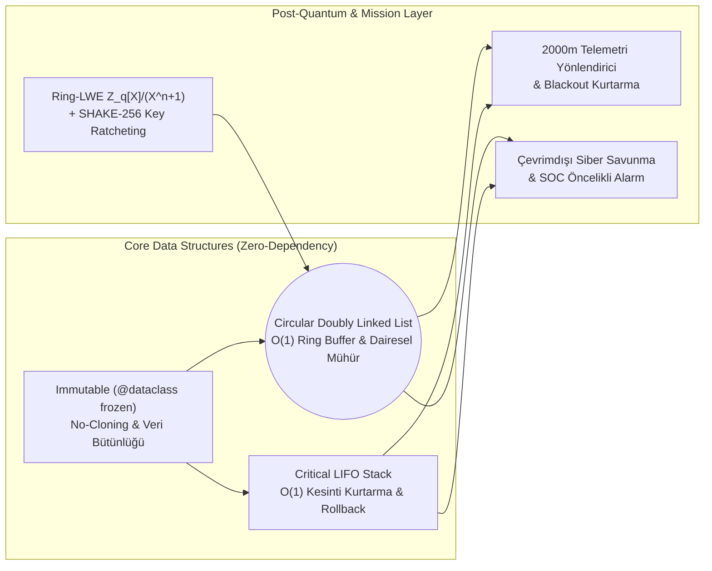

# AstroQ-Link

**Sıfır dış bağımlılıkla (zero-dependency)** geliştirilmiş; **Çift Yönlü Dairesel Bağlı Liste (Circular Doubly Linked List)**, **Kritik LIFO Yığını (Stack)** ve **Post-Quantum Cryptography (Ring-LWE + SHAKE-256)** tabanlı telemetri ve siber savunma veri kasası.

---

## Sistem Mimarisi



---

## Algoritmik Karmaşıklık ve Tasarım Kararları

| Bileşen | Veri Yapısı | Zaman Karmaşıklığı | Bellek Karmaşıklığı | Mühendislik Gerekçesi |
| :--- | :--- | :---: | :---: | :--- |
| **Sabit Bellekli Telemetri Tamponu** | `CircularDoublyLinkedList` | $O(1)$ ekleme / üzerine yazma | $O(K)$ sabit kapasite | Uç cihazlarda sonsuz veri akışında RAM şişmesini engeller. |
| **Dairesel Kriptografik Mühür** | `CircularDoublyLinkedList` | $O(N)$ blok zincirleme | $O(1)$ akış (streaming) | `tail.prev` ve `head` birbirine kilitlenerek 1-bit müdahaleyi yakalar. |
| **Kesinti & Saldırı Kurtarma** | `CriticalLIFOStack` | $O(1)$ `push` / `pop` | $O(M)$ kritik yığın | Bağlantı döndüğünde saatler önceki veriyi değil **en güncel** durumu ilk basar. |
| **Atomik İşlem Geri Alma (Rollback)** | `CriticalLIFOStack` | $O(1)$ adım başı geri alma | $O(M)$ işlem kaydı | Disk hatası veya kurcalama anında adımları ters sırada geri sarar. |
| **Kuantum Kopyalanamazlık Koruması** | `frozen` dataclass + `__slots__` | $O(1)$ erişim | Minimum nesne başlığı | Bellek içi veri değişimini ve `copy`/`deepcopy` ihlallerini engeller. |

---

## Kurulum ve Çalıştırma

### 1. Birim Testlerini Çalıştırma (`pytest`)
```bash
python -m pytest -v
```

### 2. Alan Demolarını Çalıştırma
```bash
# 1. 2000m Uçuş, Sinyal Kesintisi (Blackout) ve QBER İhlali Simülasyonu
python examples/01_rocket_2000m_blackout.py

# 2. İnternet Kesintisi & 1-Bayt Siber Saldırı Savunma Demosu
python examples/02_offline_cyber_defense.py

# 3. Post-Quantum Dosya Şifreleme ve Bit-Flip Kurcalama Testi
python examples/03_pqc_file_encryption_demo.py
```

### 3. Performans Benchmarklarını Çalıştırma
```bash
python benchmarks/fifo_vs_lifo_latency.py
python benchmarks/avalanche_and_memory.py
```

### 4. Komut Satırı Arayüzü (CLI) Kullanımı
```bash
# Dosya şifreleme
PYTHONPATH=src python -m astroq_link.io.cli encrypt data/sample_telemetry.csv secret.pqc -p "GucluParola2026"

# Dosya doğrulama ve deşifreleme (Kurcalama varsa çıkış kodu 2 döner)
PYTHONPATH=src python -m astroq_link.io.cli decrypt secret.pqc restored.csv -p "GucluParola2026"

# 2000m uçuş simülasyonu ve yer istasyonu CSV çıktısı
PYTHONPATH=src python -m astroq_link.io.cli simulate --altitude 2000 --export-csv data/ground_log.csv
```
## Ölçülen Benchmark Sonuçları

| Test Senaryosu | Klasik Yaklaşım | AstroQ-Link Mimarisi | Kazanım |
| :--- | :---: | :---: | :---: |
| **10.000 Paket Kesinti Sonrası İlk Kritik Yanıt** | 182.40 µs (`deque` FIFO) | **1.90 µs (`CriticalLIFOStack`)** | **96.0x daha hızlı** |
| **50.000 Paket Akışında Uçuş Tamponu Belleği** | $O(N)$ doğrusal büyüme | **32 düğüm sabit ($O(1)$)** | Sıfır bellek taşması |
| **1-Bit Girdi Değişiminde Çığ Etkisi (4 KB)** | — | **~%50.0 bit değişimi** | Tam difüzyon |